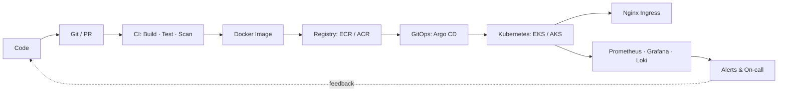

# Hi, I'm Hamza Shah 👋

### DevOps / Cloud Engineer · SysAdmin · Observability Enthusiast

*Turning "it works on my machine" into everyone's problem* 🃏

  
  
  

---

## 🧑‍💻 About Me

- ☁️ I design, automate and operate **cloud infrastructure** on **AWS** and **Azure**
- 🐳 I package, ship and run workloads with **Docker** and **Kubernetes**
- 🏗️ I treat infrastructure as code: **Terraform**, **Ansible**, **Helm**, **GitOps**
- 🔁 I build **CI/CD pipelines** that make deployments boring (in a good way)
- 📊 I care about **observability**: metrics, logs, traces and alerts that actually mean something
- 🐧 I'm a **Linux / SysAdmin** at heart: hardening, networking, troubleshooting at 3 AM
- 🤖 Currently exploring **AIOps**: using LLMs to speed up incident diagnosis and root cause analysis
- 📍 Based in Pakistan 🇵🇰 (UTC +05:00)

---

## 🛠️ Tech Stack

### ☁️ Cloud Platforms

  

**AWS:** EC2 · EKS · ECS · S3 · VPC · IAM · RDS · Lambda · ALB/NLB · Route 53 · CloudFront · CloudWatch · CloudFormation · Secrets Manager · SQS/SNS
**Azure:** VMs · AKS · VNet · Azure AD / Entra ID · Blob Storage · Azure DevOps · Azure Monitor · Key Vault · ACR

### 🏗️ Infrastructure as Code & Configuration Management

  

`Terraform` · `Terraform Modules & Remote State` · `Ansible` · `CloudFormation` · `Packer` · `Shell Scripting` · `Python Automation`

### 🐳 Containers & Orchestration

  

### 🔁 CI/CD & GitOps

  

`GitHub Actions` · `GitLab CI` · `Jenkins` · `Azure DevOps Pipelines` · `Argo CD` · `Trunk-based & GitFlow` · `Blue/Green & Canary Deployments`

### 🌐 Web Servers, Proxies & Networking

  

`Reverse Proxy` · `Load Balancing` · `SSL/TLS Termination` · `Rate Limiting` · `Ingress Controllers` · `DNS` · `VPN` · `Firewalls` · `TCP/IP`

### 📊 Observability & Monitoring

`CloudWatch` · `Azure Monitor` · `Node Exporter` · `kube-state-metrics` · `Blackbox Exporter` · `SLIs / SLOs / Error Budgets` · `Alerting & On-call` · `Distributed Tracing`

### 🔐 Security & DevSecOps

`IAM & RBAC` · `Secrets Management` · `Image Scanning` · `SAST / DAST` · `Network Policies` · `OS Hardening` · `Least Privilege`

### 🐧 Systems & Scripting

  

`Linux Administration` · `systemd` · `cron` · `Bash` · `Python` · `Networking & Troubleshooting` · `Backup & Disaster Recovery`

---

## 🚀 Featured Projects

| Project | Description | Stack |
|---|---|---|
| [**E-Commerce-Microservices**](https://github.com/hamzashah14/E-Commerce-Microservices) | Seven-service e-commerce sample app used as a DevOps workload: Docker Compose locally, GitHub Actions CI pushing images to Amazon ECR, Argo CD GitOps with Kustomize on EKS, and Prometheus + Grafana observability. | `Docker` `GitHub Actions` `Argo CD` `Kubernetes` `Prometheus` `Grafana` |
| [**E-Commerce-Infrastructure**](https://github.com/hamzashah14/E-Commerce-Infrastructure) | Terraform modules for the AWS platform behind it: VPC, EKS 1.34, ECR, plus Argo CD and kube-prometheus-stack installed with Helm. | `Terraform` `AWS EKS` `ECR` `Helm` `Argo CD` |
| [**AIOps-Agent**](https://github.com/hamzashah14/AIOps-Agent) | AI-powered SRE assistant that diagnoses production incidents by querying CloudWatch Logs, Prometheus metrics and EKS cluster health, then provides root cause analysis, evidence and fix recommendations. | `Python` `AWS EKS` `CloudWatch` `Prometheus` `LLM` |
| [**PSX-CloudETL**](https://github.com/hamzashah14/PSX-CloudETL) | Python ETL pipeline for the public PSX data API, built with a microservices architecture and deployable on the cloud, Kubernetes or Docker Compose. A full hands-on project for DevOps learners. | `Python` `Docker` `Kubernetes` `Microservices` |
| [**Packet-inspection**](https://github.com/hamzashah14/Packet-inspection) | High-performance Deep Packet Inspection (DPI) engine written in C++17. | `C++17` `Networking` |

---

## 🗺️ What I Work On

---

## 📈 GitHub Stats

---

## 🎯 Currently

- 🔭 Building out **AIOps / SRE automation** with LLMs
- 🌱 Going deeper into **Kubernetes internals**, **GitOps** and **platform engineering**
- 📚 Sharpening **observability** practice: SLOs, tracing and smarter alerting
- 🤝 Open to collaborating on **DevOps, cloud and open-source infrastructure** projects

---

## 📫 Let's Connect

*"If it's not monitored, it's not production."* 🚦

