  

## `$ cat about.md`

- Cloud infrastructure on **AWS** and **Azure**, defined as code with **Terraform** and **Ansible**
- Containers on **Docker** and **Kubernetes**, delivered through **CI/CD** and **GitOps**
- Building AIOps / SRE automation with LLMs
- Based in Pakistan, UTC+05:00

## `$ ls projects/`

- [`Tracaus`](https://github.com/hamzashah14/Tracaus): AI incident investigator for AWS EC2/ECS — reads CloudWatch alarms, logs and metrics, emails root-cause reports
- [`E-Commerce-Microservices`](https://github.com/hamzashah14/E-Commerce-Microservices): 7-service sample app with Docker Compose, GitHub Actions CI, Argo CD GitOps and Prometheus + Grafana on EKS
- [`E-Commerce-Infrastructure`](https://github.com/hamzashah14/E-Commerce-Infrastructure): Terraform for AWS: VPC, EKS, ECR, Argo CD and kube-prometheus-stack
- [`PSX-CloudETL`](https://github.com/hamzashah14/PSX-CloudETL): Python ETL pipeline for the public PSX data API, deployable on the cloud, Kubernetes or Docker Compose
- [`Packet-Inspection-Engine`](https://github.com/hamzashah14/Packet-inspection): High-performance Deep Packet Inspection (DPI) engine in C++17

## `$ ./contact.sh`

[`linkedin`](https://www.linkedin.com/in/hamzashah658) · [`email`](mailto:hamzaashah14@gmail.com) · [`github`](https://github.com/hamzashah14)
